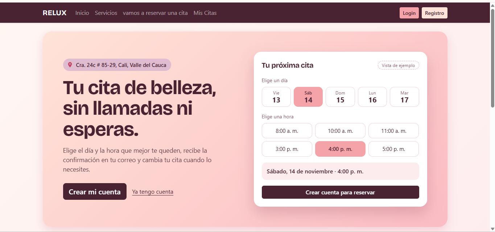

# Manual de usuario

## Manual de usuario

### 1. Introducción

Este manual explica cómo utilizar AppSalonCitas (RELUX), una aplicación web para consultar servicios de un salón de belleza y gestionar reservas de citas.

El sistema cuenta con dos tipos principales de usuarios: clientes y administradores. Cada uno dispone de funciones de acuerdo con su rol.

### 2. Acceso a la aplicación

Al ingresar a la aplicación se muestra la página principal.

Desde allí se puede consultar la información disponible y acceder a las opciones de registro e inicio de sesión.

<figure><figcaption></figcaption></figure>

### 3. Registro de un cliente

Para crear una cuenta:

1. Ingresar a la opción de registro.
2. Completar los campos solicitados.
3. Escribir el nombre, apellido, correo electrónico y teléfono.
4. Introducir una contraseña y su confirmación.
5. Seleccionar la opción para registrar la cuenta.

El sistema valida los datos antes de crear el usuario. Si el registro se realiza correctamente, muestra un mensaje de confirmación y dirige al inicio de sesión.

<figure><figcaption></figcaption></figure>

### 4. Inicio de sesión

Para ingresar:

1. Abrir la opción de inicio de sesión.
2. Escribir el correo electrónico registrado.
3. Introducir la contraseña.
4. Seleccionar la opción para ingresar.

El sistema identifica el rol de la cuenta y dirige al usuario a la sección correspondiente.

Los clientes ingresan a la parte destinada a sus operaciones y los administradores acceden al panel administrativo.

<figure><figcaption></figcaption></figure>

<figure><figcaption></figcaption></figure>

<figure><figcaption></figcaption></figure>

### 5. Consulta de servicios

Para consultar los servicios:

1. Ingresar a la sección de servicios.
2. Revisar los servicios disponibles.
3. Consultar la descripción, el precio y la duración mostrados.

La aplicación dispone de una página específica para consultar el catálogo de servicios.

<figure><figcaption></figcaption></figure>

<figure><figcaption></figcaption></figure>

### 6. Reserva de una cita

Para solicitar una cita:

1. Iniciar sesión con una cuenta de cliente.
2. Ingresar a la sección de reservas.
3. Seleccionar uno o varios servicios.
4. Elegir una fecha disponible.
5. Seleccionar una hora dentro del horario de atención.
6. Enviar la solicitud.

El sistema valida la información antes de procesar la reserva.

La fecha no puede ser anterior al día actual. Además, el sistema comprueba que el día esté habilitado y que la hora se encuentre dentro del horario configurado.

Las citas se registran inicialmente con el estado pendiente, de acuerdo con el comportamiento documentado en las pruebas.

<figure><figcaption></figcaption></figure>

### 7. Consulta de mis citas

Para consultar las reservas:

1. Iniciar sesión.
2. Ingresar a la sección Mis Citas.
3. Revisar las citas asociadas a la cuenta.

Desde esta sección se pueden utilizar las opciones disponibles para consultar, editar o cancelar las citas.

<figure><figcaption></figcaption></figure>

### 8. Edición y cancelación de citas

La aplicación cuenta con una opción para editar citas mediante la página correspondiente.

También permite cancelar una cita desde la opción disponible en Mis Citas.

Las operaciones se procesan mediante las rutas correspondientes y las validaciones del sistema.

<figure><figcaption></figcaption></figure>

### 9. Funciones del administrador

El administrador dispone de un panel con funciones para gestionar el salón.

#### Gestión de usuarios

Permite consultar los usuarios registrados y actualizar sus roles mediante las opciones administrativas.

<figure><figcaption></figcaption></figure>

#### Gestión de servicios

Permite consultar, crear, editar y eliminar servicios.

<figure><figcaption></figcaption></figure>

#### Gestión de citas

Permite consultar las citas de los clientes y actualizar sus estados.

<figure><figcaption></figcaption></figure>

#### Gestión de horarios

Permite configurar los días de atención, activar o desactivar días y establecer las horas de inicio y finalización.

<figure><figcaption></figcaption></figure>

#### Reportes

Permite consultar reportes mediante filtros de fechas y descargar la información en PDF y Excel.

<figure><figcaption></figcaption></figure>

### 10. Cierre de sesión

Para salir de la aplicación se debe utilizar la opción de cerrar sesión disponible en la interfaz.

### 11. Recomendaciones de uso

* Verificar los datos antes de enviar formularios.
* Utilizar un correo electrónico válido.
* Seleccionar servicios existentes.
* Consultar los horarios disponibles antes de reservar.
* Revisar el estado de las citas.
* No compartir las credenciales de acceso.

### 12. Conclusión

AppSalonCitas permite organizar las reservas y administrar los servicios y horarios del salón desde una aplicación web. Las opciones disponibles dependen del rol con el que se haya iniciado sesión.
